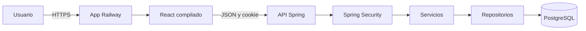
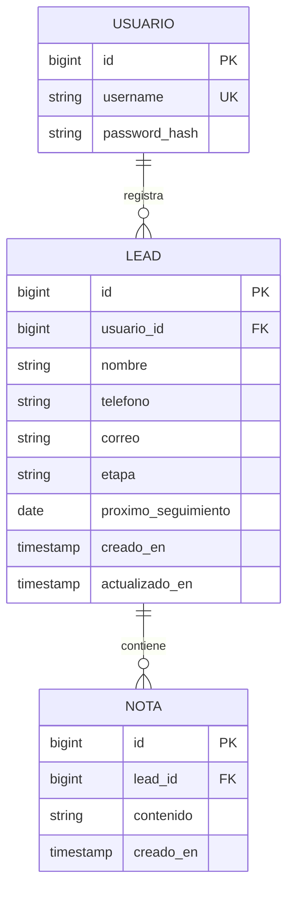

# Arquitectura y seguridad

UrLeads será una aplicación web de una sola unidad desplegable, con frontend React y backend Spring Boot. En producción Spring servirá los archivos del frontend y la API desde una misma URL.

## Tecnologías previstas

| Capa | Elección | Motivo |
|---|---|---|
| Frontend | React, TypeScript y Vite | El equipo ya conoce React y obtiene tipado y build rápido. |
| UI | Tailwind CSS y shadcn/ui | Sistema visual consistente y componentes accesibles. |
| Rutas | React Router | Rutas públicas y privadas del dashboard. |
| Datos remotos | TanStack Query y `fetch` | Estados de carga/error e invalidación tras mutaciones. |
| Backend | Java 21 y Spring Boot | Requisito y objetivo del curso. |
| API | Spring MVC | Controladores REST y manejo de HTTP. |
| Persistencia | Spring Data JPA y PostgreSQL | Persistencia relacional exigida/recomendada. |
| Seguridad | Spring Security y BCryptPasswordEncoder | Login, protección de rutas y hash de contraseña. |
| Validación | Bean Validation | Restricciones en DTO de entrada. |
| Migraciones | Flyway | Cambios de esquema versionados. |
| Build Java | Maven Wrapper | Build reproducible en los equipos. |
| Tests | JUnit, Spring Boot Test y MockMvc | Pruebas unitarias y de integración. |
| Entorno local | Docker Compose para PostgreSQL | Base local uniforme, sin depender de nube durante desarrollo. |
| CI | GitHub Actions | Ejecutar tests, lint y builds en pull requests. |
| Producción | Railway | App y PostgreSQL gestionados. |

Las versiones exactas se fijarán al implementar, comprobando compatibilidad con Java 21 y el curso. React no requiere Next.js para este dashboard privado: Spring será el servidor y proveedor de la API.

## Vista de componentes



## Modelo de datos

El esquema relacional inicial se encuentra implementado mediante la migración versionada de Flyway `V1__initial_schema.sql` (tarea UL-03 / DSW-10). Define las tablas `usuario`, `lead` y `nota`, sus claves foráneas, índices prácticos y restricciones de integridad (nombre de 2 a 120 caracteres, al menos un medio de contacto no vacío, etapas permitidas, invariante de lead cerrado sin fecha de seguimiento y eliminación de notas en cascada al suprimir un lead). Las entidades y repositorios JPA se implementarán en la siguiente tarea (UL-07).



## Capas del backend

Los controladores reciben y devuelven DTO. Los servicios aplican reglas de negocio. Los repositorios consultan entidades JPA. Las entidades no se devuelven directamente al frontend. Configuración y secretos entran por variables de entorno, nunca se guardan en Git.

## Autenticación y seguridad

- Sesión de Spring Security con cookie HttpOnly; Secure en producción y `SameSite` apropiado.
- Se conserva protección CSRF. El frontend y Postman obtienen el token desde `/api/auth/csrf` y lo envían en las solicitudes que modifican estado.
- Login rota el identificador de sesión; logout invalida la sesión.
- No guardar tokens de sesión en `localStorage` ni implementar criptografía propia.
- Hash con `BCryptPasswordEncoder`; el hash nunca se devuelve por la API.
- Las consultas restringen leads al usuario autenticado.
- Respuestas de error no exponen trazas ni secretos.
- Un único usuario de producto no significa eliminar la asociación de dueño: esta evita acceso cruzado accidental y permite ampliar el sistema más adelante.

### Distinción de cuentas y accesos

- **Usuario de base de datos (`urleads_app`):** credencial técnica que utiliza Spring Boot para conectarse a PostgreSQL mediante JDBC/JPA. Sus permisos se restringen a las operaciones necesarias sobre el esquema `public`.
- **Usuario de la aplicación (tabla `usuario`):** operador del CRM que inicia sesión vía HTTP en la plataforma. Sus credenciales se validan mediante Spring Security y su contraseña se almacena como hash BCrypt.

Estas cuentas tienen propósitos distintos. La cuenta técnica permite que el backend acceda a la base de datos; la cuenta de aplicación permite que una persona acceda al CRM. No deben utilizarse indistintamente.

### Aprovisionamiento de la cuenta inicial (Bootstrap)

UrLeads **no cuenta con registro público** (`/api/auth/register`) por diseño. La cuenta de acceso inicial se genera de forma manual y privada directamente en la base de datos.

#### 1. Generar el hash BCrypt

El hash se debe generar sin escribir la contraseña en el código fuente ni dejarla en el historial de comandos.

Una alternativa es utilizar JShell con el `BCryptPasswordEncoder` de Spring Security. Si las dependencias de Spring Security están disponibles en el classpath, se puede ejecutar el siguiente código Java:

```java
import org.springframework.security.crypto.bcrypt.BCryptPasswordEncoder;
import java.io.Console;

Console console = System.console();
if (console == null) {
    throw new IllegalStateException(
        "Ejecute este programa desde una terminal interactiva."
    );
}

char[] password = console.readPassword("Ingrese password: ");
String hash = new BCryptPasswordEncoder().encode(new String(password));
System.out.println(hash);
java.util.Arrays.fill(password, '\0');
```

El código debe ejecutarse en un entorno que tenga disponible la dependencia de Spring Security. Otra opción es crear temporalmente una clase Java dentro del proyecto y ejecutarla con el classpath adecuado.

**Importante:** el hash generado se utiliza para aprovisionar la cuenta; nunca se debe guardar la contraseña en texto plano ni incluirla en Git.

#### 2. Insertar el usuario en la base de datos `urleads`

Conectarse a la base de datos mediante un cliente SQL con permisos de administración y ejecutar:

```sql
INSERT INTO usuario (username, password_hash)
VALUES ('operador', '<HASH_BCRYPT_GENERADO>');
```

Reemplazar `<HASH_BCRYPT_GENERADO>` por el hash BCrypt obtenido en el paso anterior.

El nombre `operador` es un ejemplo y puede cambiarse según las necesidades del despliegue. Debe respetarse el esquema y las restricciones definidos por la migración de Flyway.

La cuenta administrativa utilizada para aprovisionar al usuario debe ser distinta de la cuenta técnica de la aplicación siempre que sea posible. Una vez creado el usuario inicial, el acceso al CRM se realiza mediante el endpoint de login.

### Endurecimiento para producción (cookies de sesión)

En producción, UrLeads debe ejecutarse detrás de HTTPS (TLS). La cookie de sesión debe incluir el atributo `Secure` para que el navegador solo la envíe mediante conexiones cifradas.

Se utilizará la siguiente variable de entorno:

```ini
COOKIE_SECURE=true
```

Esta variable debe mapearse explícitamente en la configuración de Spring Boot a la propiedad:

```properties
server.servlet.session.cookie.secure=${COOKIE_SECURE:true}
```

El valor predeterminado `true` favorece una configuración segura. Para desarrollo local mediante HTTP, se puede definir `COOKIE_SECURE=false` únicamente en el entorno local, nunca como configuración de producción.

La configuración de cookies también debe contemplar los siguientes atributos:

```properties
server.servlet.session.cookie.http-only=true
server.servlet.session.cookie.same-site=lax
```

Estas propiedades deben comprobarse contra la versión de Spring Boot utilizada. El atributo `SameSite` puede configurarse mediante la propiedad de sesión correspondiente o una configuración específica de cookies si la versión lo requiere.

#### Atributos de seguridad de las cookies emitidas

Al autenticarse correctamente en `/api/auth/login`, el servidor debe emitir una cookie de sesión con atributos equivalentes a los siguientes:

```http
Set-Cookie: JSESSIONID=[REDACTED]; Path=/; Secure; HttpOnly; SameSite=Lax
```

Si se utiliza una cookie `XSRF-TOKEN` para transportar el token CSRF, esta puede tener un formato similar al siguiente:

```http
Set-Cookie: XSRF-TOKEN=[REDACTED]; Path=/; Secure; SameSite=Lax
```

Los encabezados anteriores son ejemplos ilustrativos, no una garantía de que Spring Security los emita automáticamente con esos valores. La cookie CSRF debe configurarse de acuerdo con la estrategia seleccionada para que el frontend pueda obtener y enviar el token sin desactivar la protección CSRF.

- **`HttpOnly`:** impide que JavaScript del navegador lea directamente la cookie de sesión mediante `document.cookie`. No elimina el riesgo de XSS, por lo que también se deben prevenir las vulnerabilidades de inyección de scripts.
- **`SameSite=Lax`:** limita el envío de cookies en determinados contextos de navegación entre sitios y ayuda a mitigar ataques CSRF. No sustituye la protección CSRF de Spring Security.
- **`Secure`:** restringe el envío de la cookie a conexiones HTTPS.
- **`Path=/`:** permite que la cookie se envíe a las rutas del mismo host que correspondan a esa ruta.

La cookie de sesión no debe estar disponible para JavaScript. Si se utiliza una cookie CSRF accesible desde el frontend, esta no debe contener el identificador de sesión ni otros secretos de autenticación.

#### Gestión de sesión

- El inicio de sesión debe renovar el identificador de sesión para prevenir la fijación de sesión.
- El cierre de sesión debe invalidar la sesión del servidor y limpiar las cookies correspondientes cuando proceda.
- Los endpoints que modifican datos deben exigir un token CSRF válido.
- Los errores de autenticación no deben revelar si una contraseña concreta es correcta ni exponer información sensible.
- No se deben registrar contraseñas, hashes de contraseñas, identificadores de sesión ni tokens CSRF en los logs.

## Decisiones de despliegue

Railway alojará dos servicios: la aplicación Spring Boot y PostgreSQL. La base no tendrá acceso público si la plataforma permite conexión privada. La aplicación respetará el puerto asignado, contará con healthcheck y persistencia de PostgreSQL. No se añaden microservicios, Kubernetes, Redis ni procesos Node en producción.